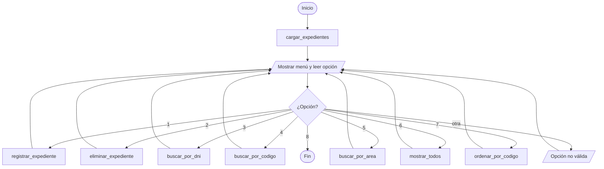
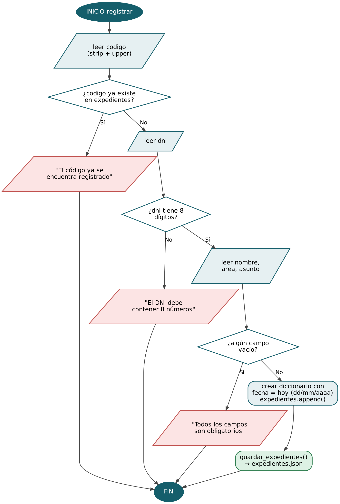

# Mesa de Partes Digital – Centro de Salud


Prototipo de consola en Python que digitaliza el registro de expedientes de la mesa de partes del área de **Admisión** de un centro de salud del MINSA. Permite **registrar, validar, buscar, ordenar, eliminar y guardar** expedientes en un archivo de texto, sin bases de datos ni librerías externas.

Proyecto del desafío **«Del archivador al algoritmo: un prototipo para la mesa de partes digital»**, curso *Fundamentos de Programación (CIIN1205P)*, Universidad Privada del Norte.

---

## Contenido

- [Contexto y problema](#contexto-y-problema)
- [Funcionalidades](#funcionalidades)
- [Demostración](#demostración)
- [Instalación y uso](#instalación-y-uso)
- [Estructura del repositorio](#estructura-del-repositorio)
- [Formato de los datos](#formato-de-los-datos)
- [Diseño del algoritmo](#diseño-del-algoritmo)
- [Pruebas](#pruebas)
- [Limitaciones y trabajo futuro](#limitaciones-y-trabajo-futuro)
- [Equipo](#equipo)
- [Licencia](#licencia)

---

## Contexto y problema

La **Ley N.° 31170** obliga a las entidades del Estado a implementar mesas de partes digitales. En el área de Admisión del **Centro de Salud Tupac Amaru (MINSA, categoría I-3)** se observó, el 03/10/2026, que:

- Se atienden **20 a 30 historias por día**.
- La historia clínica se busca **a mano en archivadores** ordenados por número.
- Los problemas frecuentes son la **pérdida** y la **duplicidad** de historias.


El diagrama de Ishikawa resume las causas del problema en seis categorías (6M):


**Solución:** un registro digital propio, con código único, validaciones y búsqueda inmediata, que se guarda en un archivo para no perder ningún trámite.


> El prototipo solo guarda **datos administrativos** del trámite (código, DNI, nombre, área, asunto y fecha). No guarda diagnósticos ni información clínica, y todos los datos de ejemplo son **ficticios**.

---

## Funcionalidades

| Opción | Función | Qué hace |
|:-:|---|---|
| 1 | `registrar_expediente()` | Registra un expediente con la fecha del día. Valida código único, DNI de 8 dígitos, campos obligatorios y que no se use `;` |
| 2 | `eliminar_expediente()` | Elimina un expediente por su código |
| 3 | `buscar_por_dni()` | Muestra todos los expedientes de un DNI |
| 4 | `buscar_por_codigo()` | Muestra el expediente con ese código |
| 5 | `buscar_por_area()` | Muestra los expedientes de un área (sin importar mayúsculas) |
| 6 | `mostrar_todos()` | Lista todos los expedientes |
| 7 | `ordenar_por_codigo()` | Ordena por código con el método burbuja y guarda el resultado |
| 8 | — | Sale del sistema |

Cada cambio se guarda automáticamente en `expedientes.txt`, y al iniciar el programa se cargan los expedientes guardados.

---

## Demostración

| Registro y búsqueda tras reiniciar | Validaciones |
|:-:|:-:|
|  |  |

---

## Instalación y uso

**Requisitos:** Python 3.10 o superior. No necesita instalar librerías.

```bash
git clone https://github.com/amiir3k/mesa-partes-digital.git
cd mesa-partes-digital
python3 principal.py
```

En Windows usa `python principal.py`.

---

## Estructura del repositorio

```
mesa-partes-digital/
├── principal.py       # Menú del sistema (while + if/elif)
├── funciones.py       # Lógica: registrar, buscar, ordenar, cargar y guardar
├── expedientes.txt    # Datos de ejemplo (ficticios); se crea solo si no existe
├── docs/img/          # Diagramas y capturas usados en este README
├── .gitignore
├── LICENSE
└── README.md
```

---

## Formato de los datos

`expedientes.txt` guarda **un expediente por línea**, con los campos separados por `;`:

```
codigo;dni;nombre;area;asunto;fecha
EXP-2026-0007;45871236;Rosa Quispe Mamani;Triaje;Apertura de historia clínica;02/11/2026
```

- Al cargar, cada línea se separa con `split(";")`. Si una línea no tiene 6 campos, se omite y se avisa.
- Por eso el sistema no permite escribir `;` dentro de los datos.

---

## Diseño del algoritmo

### Organización modular


### Flujo del programa principal



### Registro y ordenamiento

| Registro | Ordenamiento burbuja |
|:-:|:-:|
|  |  |

### Conceptos aplicados

| Concepto | Dónde |
|---|---|
| Estructuras de control | `while True` del menú, `if/elif`, `for` en búsquedas y dos `for` anidados en la burbuja |
| Funciones | 10 funciones en `funciones.py`; `mostrar_expediente(expediente)` recibe un parámetro |
| Listas (arreglos) | Lista `expedientes`: `append`, `remove` e intercambio por índice |
| Cadenas | `strip()`, `upper()`, `lower()`, `isdigit()`, `split(";")` y concatenación |
| Archivos | `open()` en modo `"r"` y `"w"` con `encoding="utf-8"` |

### Eficiencia

| Expedientes (n) | Búsqueda lineal (comparaciones) | Burbuja n(n−1)/2 (comparaciones) |
|---|---|---|
| 25 (un día) | 25 | 300 |
| 660 (un mes) | 660 | 217 470 |
| 7 920 (un año) | 7 920 | 31 359 240 |

La búsqueda lineal es suficiente incluso para un año de datos. La burbuja conviene para volúmenes diarios o mensuales.

---

## Pruebas

Se ejecutaron **18 casos de prueba**, y todos dan el resultado esperado:

| Grupo | Casos |
|---|---|
| Registro y persistencia | Registro válido; el expediente sigue al reiniciar |
| Validaciones | Código repetido, DNI de 7 dígitos, DNI con letra, campo vacío, opción inválida, `;` en los datos |
| Búsquedas | Por DNI (con y sin resultados), por código inexistente, por área en minúsculas y área sin registros |
| Ordenamiento y eliminación | Orden en pantalla y en archivo; eliminar existente e inexistente |
| Robustez | Código en minúsculas (`exp-2026-0007`) detectado como repetido; línea dañada en el archivo |

---

## Limitaciones y trabajo futuro

- [ ] Generar el código `EXP-AAAA-NNNN` automáticamente
- [ ] Volver a pedir solo el dato incorrecto, en lugar de cancelar el registro
- [ ] Elegir el área de un catálogo numerado
- [ ] Copia de respaldo (`expedientes.bak`) antes de guardar
- [ ] Reemplazar la burbuja por `sorted()` cuando haya miles de expedientes
- [ ] Migrar a una base de datos (SQLite) para varios usuarios

---

## Equipo

**Grupo 05** – Fundamentos de Programación (CIIN1205P), Facultad de Ingeniería, UPN
Docente: Ing. Jorge Chicana Aspajo

| Integrante | GitHub |
|---|---|
| Olivares Torres, Amir Alim | [amiir3k](https://github.com/amiir3k) |
| Pari Benites, Edgar Genaro | [EdgarPari2025](https://github.com/EdgarPari2025) |
| Castro Delgado, Yanilka Carla | [yamilka-cd](https://github.com/yamilka-cd) |
| Montoya Orccosupa, Renato Sebastian | [Renato123j](https://github.com/Renato123j) |
| Toboada Quispe, Cristian Alvaro | [Cristian2703-boop](https://github.com/Cristian2703-boop) |

---

## Licencia

Distribuido bajo la licencia MIT. Ver [LICENSE](LICENSE).
