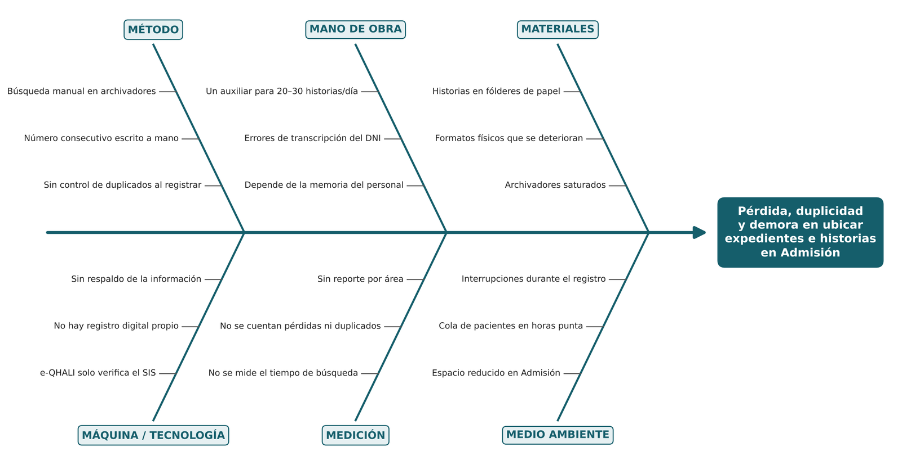
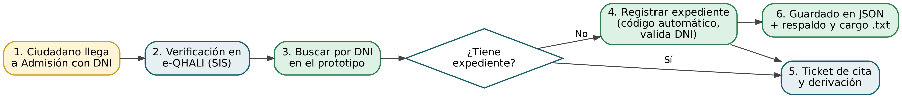
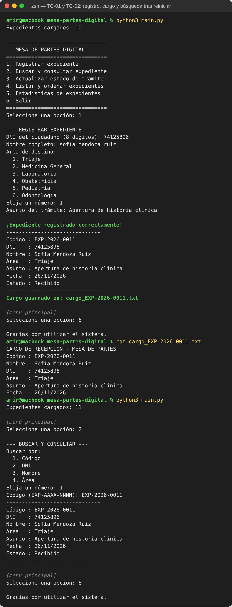
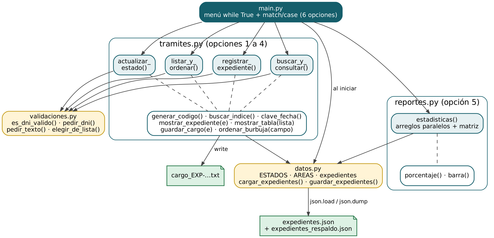
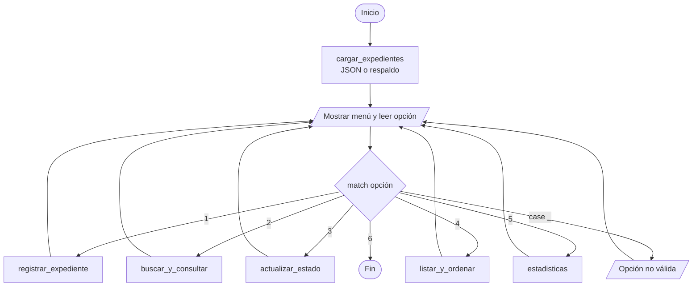
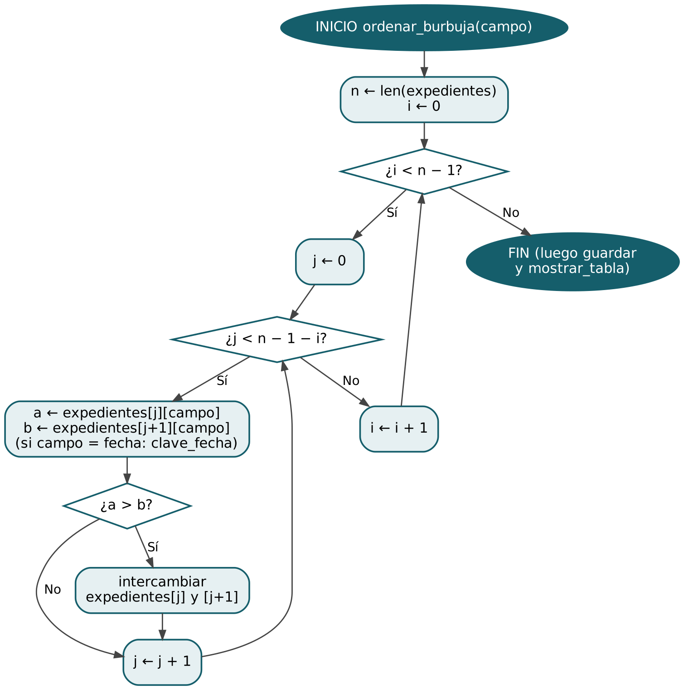

# Mesa de Partes Digital – WawaRed


Prototipo de consola en Python que digitaliza el registro de expedientes de la mesa de partes del área de **Admisión** de un centro de salud del MINSA. Permite **registrar, validar, buscar, actualizar el estado, ordenar, obtener estadísticas y guardar** expedientes en un archivo JSON con copia de respaldo, sin bases de datos ni librerías externas (solo módulos estándar de Python).

Proyecto del desafío **«Del archivador al algoritmo: un prototipo para la mesa de partes digital»**, curso *Fundamentos de Programación (CIIN1205P)*, Universidad Privada del Norte.

---

## Contenido

- [Contexto y problema](#contexto-y-problema)
- [Funcionalidades](#funcionalidades)
- [Demostración](#demostración)
- [Instalación y uso](#instalación-y-uso)
- [Estructura del repositorio](#estructura-del-repositorio)
- [Formato de los datos](#formato-de-los-datos)
- [Diseño del algoritmo](#diseño-del-algoritmo)
- [Pruebas](#pruebas)
- [Limitaciones y trabajo futuro](#limitaciones-y-trabajo-futuro)
- [Equipo](#equipo)
- [Licencia](#licencia)

---

## Contexto y problema

La **Ley N.° 31170** obliga a las entidades del Estado a implementar mesas de partes digitales. En el área de Admisión del **Centro de Salud Tupac Amaru (MINSA, categoría I-3)** se observó, el 03/10/2026, que:

- Se atienden **20 a 30 historias por día**.
- La historia clínica se busca **a mano en archivadores** ordenados por número.
- Los problemas frecuentes son la **pérdida** y la **duplicidad** de historias.


El diagrama de Ishikawa resume las causas del problema en seis categorías (6M):



**Solución:** un registro digital propio, con código único, validaciones y búsqueda inmediata, que se guarda en un archivo para no perder ningún trámite.



> El prototipo solo guarda **datos administrativos** del trámite (código, DNI, nombre, área, asunto y fecha). No guarda diagnósticos ni información clínica, y todos los datos de ejemplo son **ficticios**.

---

## Funcionalidades

| Opción | Función | Qué hace |
|:-:|---|---|
| 1 | `registrar_expediente()` | Pide el DNI (se repite hasta que tenga 8 dígitos), avisa si ese DNI ya tiene un trámite pendiente, pide nombre, área (de un catálogo numerado) y asunto. **Genera el código** `EXP-AAAA-NNNN`, pone la fecha del día y el estado **Recibido**, guarda y escribe el **cargo de recepción** en `cargo_<código>.txt` |
| 2 | `buscar_y_consultar()` | Buscar por **código**, **DNI**, **nombre** (parcial, sin importar mayúsculas) o **área**; muestra la ficha o una tabla y cuántos se encontraron |
| 3 | `actualizar_estado()` | Cambia el estado del trámite. Solo puede avanzar: Recibido → En proceso → Atendido → Archivado. Un expediente archivado ya no cambia |
| 4 | `listar_y_ordenar()` | Listar todos, **ordenar por código, nombre o fecha** (burbuja) o listar por estado |
| 5 | `estadisticas()` | Total, registrados hoy, pendientes, cantidad y **porcentaje por estado y por área** con barras, área con más trámites y **cuadro área × estado** |
| 6 | — | Sale del sistema |

Cada cambio se guarda en `expedientes.json` y en `expedientes_respaldo.json`. Si el archivo principal se daña, al iniciar se recuperan los datos del respaldo.

> Los expedientes no se eliminan: como en una mesa de partes real, un trámite terminado se **archiva** y queda en el historial.

---

## Demostración

| Registro, cargo y búsqueda tras reiniciar | Validaciones: el dato incorrecto se vuelve a pedir |
|:-:|:-:|
|  |  |

---

## Instalación y uso

**Requisitos:** Python 3.10 o superior. No necesita instalar librerías.

```bash
git clone https://github.com/amiir3k/mesa-partes-digital.git
cd mesa-partes-digital
python3 main.py
```

En Windows usa `python main.py`. Se necesita Python 3.10 o superior porque el menú usa `match/case`.

---

## Estructura del repositorio

```
mesa-partes-digital/
├── main.py            # Menú del sistema (while True + match/case)
├── datos.py           # Catálogos ESTADOS y AREAS, lista expedientes, cargar y guardar (JSON + respaldo)
├── validaciones.py    # Pedir DNI, textos y opciones hasta que sean válidos
├── tramites.py        # Opciones 1 a 4: registrar, buscar, actualizar estado, listar y ordenar
├── reportes.py        # Opción 5: estadísticas con arreglos paralelos y matriz
├── expedientes.json   # Datos de ejemplo (ficticios)
├── docs/img/          # Diagramas y capturas usados en este README
├── .gitignore
├── LICENSE
└── README.md
```

Al usar el programa se crean también `expedientes_respaldo.json` y un `cargo_EXP-AAAA-NNNN.txt` por cada registro (están en `.gitignore`).

---

## Formato de los datos

`expedientes.json` guarda una **lista de diccionarios**, uno por expediente:

```json
[
    {
        "codigo": "EXP-2026-0007",
        "dni": "45871236",
        "nombre": "Rosa Quispe Mamani",
        "area": "Triaje",
        "asunto": "Apertura de historia clínica",
        "fecha": "02/11/2026",
        "estado": "En proceso"
    }
]
```

- Al iniciar, `cargar_expedientes()` lo lee con `json.load`; después de cada cambio, `guardar_expedientes()` lo reescribe con `json.dump(..., ensure_ascii=False, indent=4)` para conservar tildes y ñ.
- Cada vez que se guarda, se escribe también `expedientes_respaldo.json`. Si el archivo principal está dañado, el programa avisa y carga el respaldo; si tampoco existe, arranca con la lista vacía.

---

## Diseño del algoritmo

### Organización modular



### Flujo del programa principal



### Registro y ordenamiento

| Registro | Ordenamiento burbuja por campo |
|:-:|:-:|
|  |  |

### Conceptos aplicados

| Concepto | Dónde |
|---|---|
| Estructuras de control | `while True` y `match/case` del menú; `while` que repite un dato inválido; `if/elif`; `for` en búsquedas y dos `for` anidados en la burbuja |
| Funciones | 20 funciones en 4 módulos; con parámetros (`mostrar_expediente(e)`, `ordenar_burbuja(campo)`) y con `return` (`es_dni_valido`, `generar_codigo`, `buscar_indice`, `porcentaje`) |
| Arreglos unidimensionales | Catálogos `ESTADOS` y `AREAS`; lista `expedientes` de diccionarios |
| Arreglos paralelos | `AREAS[i]` ↔ `por_area[i]` y `ESTADOS[j]` ↔ `por_estado[j]` en las estadísticas |
| Arreglo bidimensional | `matriz[i][j]`: expedientes del área *i* en el estado *j* |
| Cadenas | `split("-")`, `zfill(4)`, `strip()`, `upper()`, `lower()`, `title()`, `isdigit()`, `ljust()`/`rjust()`, `in`, fecha con `strftime` |
| Archivos | `json.load` / `json.dump` con respaldo; `write()` del cargo de recepción en `.txt` |
| Manejo de errores | `try/except json.JSONDecodeError` con recuperación desde el respaldo |

### Eficiencia

| Expedientes (n) | Búsqueda lineal (comparaciones) | Burbuja n(n−1)/2 (comparaciones) | Guardar JSON |
|---|---|---|---|
| 25 (un día) | 25 | 300 | 0,3 ms |
| 660 (un mes) | 660 | 217 470 (31 ms) | 3 ms |
| 7 920 (un año) | 7 920 | 31 359 240 (4,4 s) | 33 ms |

La búsqueda lineal y el archivo JSON son suficientes incluso para un año de datos. La burbuja conviene para volúmenes diarios o mensuales.

---

## Pruebas

Se ejecutaron **22 casos de prueba** y todos dan el resultado esperado.

| Grupo | Casos |
|---|---|
| Registro y persistencia | Registro válido con código automático y cargo `.txt`; el expediente sigue al reiniciar |
| Validaciones | DNI de 7 dígitos, DNI con letra, nombre vacío y área fuera de rango se vuelven a pedir; DNI con trámite pendiente avisa; opción de menú inválida |
| Búsquedas | Código en minúsculas, código inexistente, DNI, parte del nombre y área |
| Estados | Avanzar de Recibido a En proceso (se guarda); un expediente archivado no cambia |
| Listar y ordenar | Ordenar por nombre, por fecha y por código (también en el JSON); listar por estado |
| Estadísticas | Totales, porcentajes por estado y área y cuadro área × estado |
| Robustez | JSON dañado con respaldo (recupera los datos) y sin respaldo (avisa y sigue) |

---

## Limitaciones y trabajo futuro

- [x] Copia de respaldo antes de guardar
- [x] Generar el código `EXP-AAAA-NNNN` automáticamente
- [x] Volver a pedir solo el dato incorrecto
- [x] Elegir el área de un catálogo numerado
- [ ] Reemplazar la burbuja por `sorted()` cuando haya miles de expedientes
- [ ] Migrar a una base de datos (SQLite) para varios usuarios
- [ ] Usuarios y contraseña para proteger los datos personales

---

## Equipo

**Grupo 05** – Fundamentos de Programación (CIIN1205P), Facultad de Ingeniería, UPN
Docente: Ing. Jorge Chicana Aspajo

| Integrante | GitHub |
|---|---|
| Olivares Torres, Amir Alim | [amiir3k](https://github.com/amiir3k) |
| Pari Benites, Edgar Genaro | [EdgarPari2025](https://github.com/EdgarPari2025) |
| Castro Delgado, Yanilka Carla | [yamilka-cd](https://github.com/yamilka-cd) |
| Montoya Orccosupa, Renato Sebastian | [Renato123j](https://github.com/Renato123j) |
| Toboada Quispe, Cristian Alvaro | [Cristian2703-boop](https://github.com/Cristian2703-boop) |

---

## Licencia

Distribuido bajo la licencia MIT. Ver [LICENSE](LICENSE).
